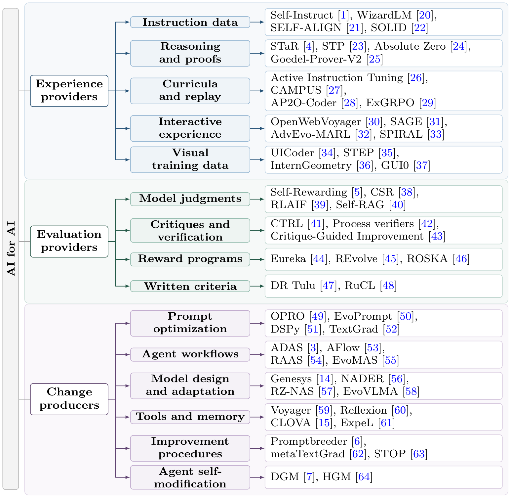

# A Survey on AI for AI: When the Improver Becomes the Improvee

Deheng Ye · Zheng Zhang · Hao Wang · Chunyan Miao

[Preprint](https://doi.org/10.20944/preprints202609.0591.v2) · [Project page](https://3dagentworld.github.io/AI4AI-survey/) · [Full text](https://3dagentworld.github.io/AI4AI-survey/paper.html) · [Browse papers](https://3dagentworld.github.io/AI4AI-survey/papers.html) · [BibTeX](#citation)

[](https://3dagentworld.github.io/AI4AI-survey/paper.html)

The survey examines how AI systems supply learning experience, evaluate outputs, and revise models or agent workflows. It traces cases where the improver itself changes and asks what evidence shows that it improves another AI system more effectively in later rounds.

## Citation

[Download BibTeX](citation.bib)

```bibtex
@article{202609.0591,
  title   = {A Survey on {AI} for {AI}: When the Improver Becomes the Improvee},
  author  = {Ye, Deheng and Zhang, Zheng and Wang, Hao and Miao, Chunyan},
  journal = {Preprints.org},
  year    = {2026},
  doi     = {10.20944/preprints202609.0591.v2},
  url     = {https://doi.org/10.20944/preprints202609.0591.v2}
}
```

## Awesome AI for AI

The survey bibliography covers 195 works. The [interactive paper list](https://3dagentworld.github.io/AI4AI-survey/papers.html) supports searching and filtering, including [entries with code](https://3dagentworld.github.io/AI4AI-survey/papers.html?code=1). The full list is also available in [PAPERS.md](PAPERS.md).

### Suggest a paper or correction

Open an [issue](https://github.com/3DAgentWorld/AI4AI-survey/issues/new) with the title, DOI or arXiv link, the relevant taxonomy category, and a sentence explaining the connection. Include the official code link when available.
